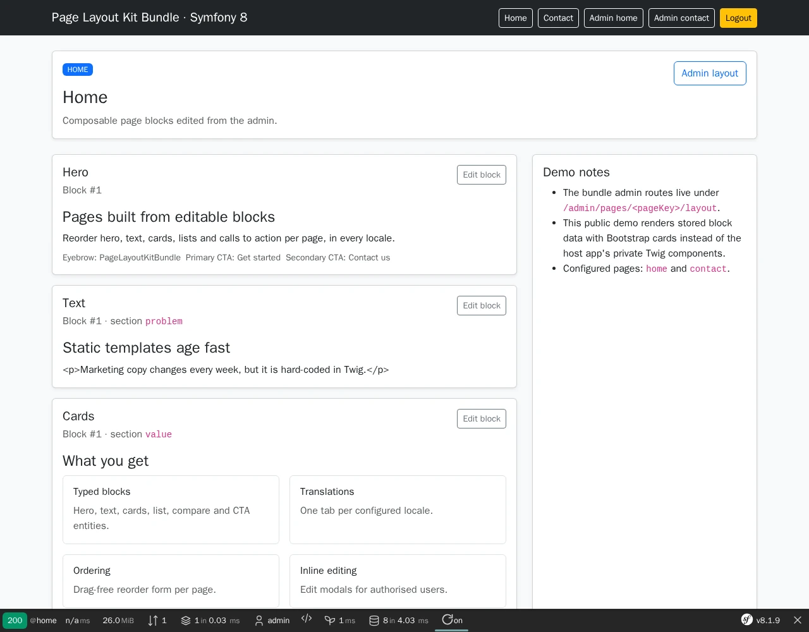
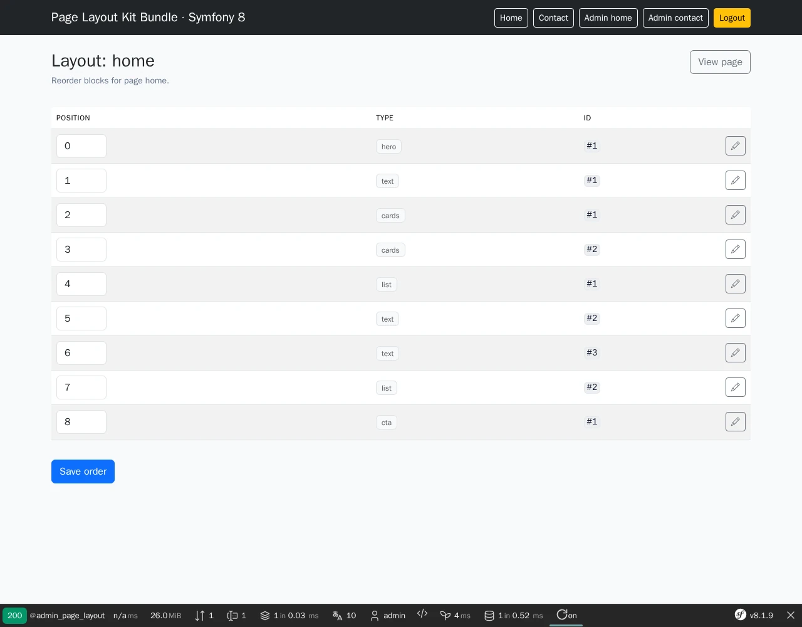

# Page Layout Kit Bundle

[](https://github.com/nowo-tech/PageLayoutKitBundle/actions/workflows/ci.yml) [](https://packagist.org/packages/nowo-tech/page-layout-kit-bundle) [](https://packagist.org/packages/nowo-tech/page-layout-kit-bundle) [](LICENSE) [](https://php.net) [](https://symfony.com) [](https://github.com/nowo-tech/PageLayoutKitBundle) [](#tests-and-coverage)

> ⭐ **Found this useful?** Give it a star on GitHub! It helps us maintain and improve the project.

**Reusable Symfony page compositor** for ordered, typed content blocks (`hero`, `text`, `cards`, `list`, `cta`, `compare`) with a secured admin reorder UI, inline CMS modals, Doctrine persistence, and Twig-based public rendering.

> Compatible with **Symfony 7.4+ and 8.x** on **PHP 8.4+**


This bundle is **FrankenPHP worker mode friendly**.

Worker mode is supported including when the kernel is **not** reset between requests (`services_resetter` off). See [FRANKENPHP-WORKER-AUDIT.md](docs/FRANKENPHP-WORKER-AUDIT.md).

<table>
  <tr>
    <td align="center" width="50%">
      
      <br /><sub>Public page rendered from ordered, typed blocks</sub>
    </td>
    <td align="center" width="50%">
      
      <br /><sub>Secured admin screen to reorder and edit the blocks of a page</sub>
    </td>
  </tr>
</table>

## What is this?

Page Layout Kit Bundle gives Symfony applications a reusable page-layout layer backed by Doctrine. Editors can manage ordered blocks for configured page keys such as `home` and `contact`, reorder them in the admin UI, and edit supported blocks through inline CMS modals. Public pages consume the resolved layout through services and Twig templates.

## Features

- Ordered typed blocks: `hero`, `text`, `cards`, `list`, `cta`, `compare`
- Configurable page keys and locales with default fallback (`es`, `en` by default)
- Admin reorder UI at `/admin/pages/{pageKey}/layout`
- Inline modal editing endpoints for supported block types
- Public rendering via `PageBlockProvider`, `PageBlockView`, and Twig templates
- Legacy fallback and migration command for pre-block JSON/content sources
- Doctrine entities, repositories, and optional table prefixing
- Configurable access guard: roles, custom checker, or demo-only unauthenticated mode
- Optional HTML sanitization for rich-text blocks (`html.sanitize`: `none`, `strip`, `allowlist`, `service`)
- Twig namespace `NowoPageLayoutKitBundle` with host override precedence
- Symfony Flex recipe and FrankenPHP demo in `demo/symfony8`

## Quick start

```bash
composer require nowo-tech/page-layout-kit-bundle:^1.1
composer require twig/extra-bundle twig/string-extra
```

```yaml
# config/packages/nowo_page_layout_kit.yaml
nowo_page_layout_kit:
    default_locale: es
    locales: [es, en]
    pages: [home, contact]
    security:
        access_roles: [ROLE_EDITOR]
```

```yaml
# config/routes/nowo_page_layout_kit.yaml
nowo_page_layout_kit:
    resource: '@NowoPageLayoutKitBundle/Resources/config/routing.yaml'
```

```bash
php bin/console doctrine:migrations:diff
php bin/console doctrine:migrations:migrate
```

Admin reorder UI: `/admin/pages/home/layout` and `/admin/pages/contact/layout`.

## Development

```bash
make up
make test
make phpstan
make igor
make -C demo/symfony8 up
make demo-smoke
```

Demo default URL: `http://localhost:8127`.

The screenshots at the top come from the demo (sign in with `admin` / `admin`). Refresh them with `make -C demo/symfony8 demo-screenshots`; `make -C demo/symfony8 test-e2e` runs the Playwright happy path.

## Documentation

- [Installation](docs/INSTALLATION.md)
- [Configuration](docs/CONFIGURATION.md)
- [Usage](docs/USAGE.md)
- [Contributing](docs/CONTRIBUTING.md)
- [Code of Conduct](CODE_OF_CONDUCT.md)
- [Changelog](docs/CHANGELOG.md)
- [Upgrading](docs/UPGRADING.md)
- [Release](docs/RELEASE.md)
- [Security](docs/SECURITY.md)
- [Engram](docs/ENGRAM.md)
- [Spec-driven development](docs/SPEC-DRIVEN-DEVELOPMENT.md)
- [GitHub Spec Kit](docs/SPEC-KIT.md)

### Additional documentation

- [PSR evaluation (REQ-CS-007)](docs/PSR.md)
- [GitHub Actions CI requirements](docs/GITHUB_CI.md)
- [Demo with FrankenPHP](docs/DEMO-FRANKENPHP.md)
- [FrankenPHP worker mode audit](docs/FRANKENPHP-WORKER-AUDIT.md)

## Tests and coverage

| Area | Status | Command |
| --- | --- | --- |
| PHP `src/` coverage | **100%** lines (1908/1908; CI gate ≥99%) | `make test-coverage` |
| TS/JS | N/A (the shipped `cms_modal_controller.ts` is copied by hosts; no build or test suite in this bundle) | — |
| Python | N/A | — |
| Unit and bundle QA | Enabled | `make test` |
| Full release checks | Enabled | `make release-check` |

```bash
make test
make test-coverage
make release-check
```

## License

MIT — see [LICENSE](LICENSE).
